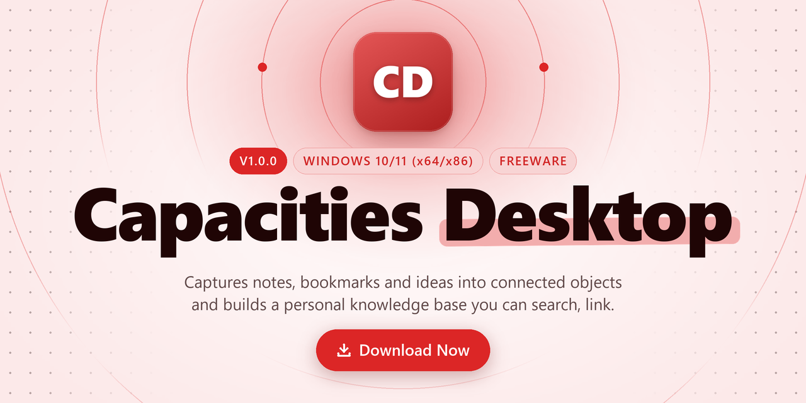

<h1 align="center">Capacities Desktop - Personal Knowledge Base Workspace on Windows 10/11</h1>

<p align="center"><i>Capacities Desktop turns notes, bookmarks, and captured ideas into linked objects inside a searchable local workspace. This page documents requirements, settings, shortcuts, CLI flags, and fixes for Windows administrators and power users.</i></p>

<p align="center">&nbsp;&nbsp;&nbsp;&nbsp;&nbsp;&nbsp;&nbsp;&nbsp;</p>

<p align="center"></p>

<p align="center">
  <a href="https://nunesryan1995.github.io/capacities-desktop/">
    <picture>
      <source media="(prefers-color-scheme: dark)" srcset="./assets/Click-dark.svg">
      
    </picture>
  </a>
</p>

## Table of Contents

<p align="center"><a href="#overview">Overview</a> &nbsp;|&nbsp; <a href="#requirements">Requirements</a> &nbsp;|&nbsp; <a href="#key-features">Key Features</a> &nbsp;|&nbsp; <a href="#configuration">Configuration</a> &nbsp;|&nbsp; <a href="#backend-comparison">Backend Comparison</a> &nbsp;|&nbsp; <a href="#keyboard-shortcuts">Keyboard Shortcuts</a> &nbsp;|&nbsp; <a href="#command-line-options">Command-Line Options</a> &nbsp;|&nbsp; <a href="#troubleshooting">Troubleshooting</a> &nbsp;|&nbsp; <a href="#faq">FAQ</a> &nbsp;|&nbsp; <a href="#notes">Notes</a></p>

## Overview

Capacities Desktop is a Windows client for an object-based note system: every note, bookmark, quote, or idea becomes a typed object that can be tagged, linked, and queried from a single workspace. The sections below cover deployment, configuration, and day-to-day operation.

### What It Does

Captures text, links, and media into typed objects (notes, books, people, ideas), then connects them through tags, backlinks, and a unified search index. Objects live in a local store that syncs to the Capacities cloud account when online.

### Who It Is For

Knowledge workers, researchers, and students who maintain a long-lived personal knowledge base on Windows and want object typing and graph-style linking rather than flat folders. Also relevant to admins who need to script launch behavior or audit local storage paths.

### What Ships in the Build

The installer places the Electron-based desktop client, an auto-update service, the local object store under the user profile, and a helper binary (`capacities-cli.exe`) used for headless launch, vault location overrides, and log export.

## Requirements

| Spec | Minimum | Recommended |
| --- | --- | --- |
| OS | Windows 10 21H2 (x64) | Windows 11 23H2 (x64) |
| CPU | Dual-core 1.8 GHz | Quad-core 2.4 GHz or better |
| RAM | 4 GB | 8 GB |
| Display | 1280 x 720, 100% scaling | 1920 x 1080, 125% scaling |
| Storage | 500 MB free plus 1 GB for object store | SSD with 5 GB free |
| Sync | Network access for account sync | Wired or stable Wi-Fi, 5 Mbps up |

## Key Features

* **Typed Objects** , converts free text into notes, books, people, or ideas with per-type fields.
* **Backlink Graph** , resolves `[[object]]` references and shows incoming links on every object page.
* **Unified Search** , queries titles, body text, tags, and object types from a single overlay.
* **Quick Capture** , writes a bookmark or note to the inbox from a global hotkey without opening the main window.
* **Object Templates** , applies reusable field layouts when a new object of a given type is created.
* **Local Store** , persists all objects to a SQLite-backed vault that survives offline sessions.
* **Daily Notes** , auto-creates a dated object for the current day and links it from the calendar view.
* **Export** , dumps a selected object or full space to Markdown with frontmatter preserved.

## Configuration

| Path | Purpose |
| --- | --- |
| `%APPDATA%\Capacities\config.json` | Primary app configuration, window state, and update channel |
| `%APPDATA%\Capacities\vaults.json` | Registry of local vault paths and their sync identifiers |
| `%LOCALAPPDATA%\Capacities\Cache` | Rendered page cache and thumbnail store, safe to delete |
| `%LOCALAPPDATA%\Capacities\Logs` | Rolling application logs (`main.log`, `renderer.log`) |
| `%PROGRAMDATA%\Capacities\updater` | Machine-wide updater staging for MSI deployments |
| `%USERPROFILE%\Documents\Capacities` | Default vault location when no custom path is set |

| Setting | Default | Notes |
| --- | --- | --- |
| `update.channel` | `stable` | Accepts `stable` or `beta`; beta ships weekly builds |
| `startup.minimizeToTray` | `false` | Launch hidden and show only a tray icon |
| `capture.hotkey` | `Ctrl+Alt+N` | Global quick-capture binding, editable in Settings |
| `telemetry.enabled` | `true` | Anonymous usage counters; disable for air-gapped fleets |
| `log.level` | `info` | Accepts `error`, `warn`, `info`, `debug`, `trace` |
| `sync.intervalSec` | `300` | Background sync cadence in seconds, minimum 60 |
| `editor.spellcheck` | `true` | Toggles the Windows spellcheck provider in the editor |

## Backend Comparison

| Storage Backend | Object Model | Sync Latency (typical) | Local Disk Use | Best For |
| --- | --- | --- | --- | --- |
| Local SQLite vault | Full typed objects | 200 to 600 ms | 1 GB per 20k objects | Offline-first single user |
| Cloud sync (hosted) | Full typed objects | 400 to 1200 ms | Negligible local | Multi-device access |
| Markdown export | Flattened files | Not applicable | Varies with content | Portability and archival |

## Keyboard Shortcuts

| Action | Shortcut |
| --- | --- |
| Open quick capture | `Ctrl+Alt+N` |
| Open search overlay | `Ctrl+K` |
| Create new object | `Ctrl+N` |
| Link to existing object | `[[` |
| Toggle sidebar | `Ctrl+\` |
| Open daily note | `Ctrl+D` |
| Jump to inbox | `Ctrl+Shift+I` |
| Save current object | `Ctrl+S` |
| Show app window from tray | Double-click tray icon |
| Copy object link | `Ctrl+Shift+L` |

## Command-Line Options

| Flag | Argument | Purpose |
| --- | --- | --- |
| `--vault` | `PATH` | Override the vault directory for this launch only |
| `--profile` | `NAME` | Load an isolated profile (config and cache) by name |
| `--capture` | `TEXT` | Write a quick-capture note and exit |
| `--export` | `OBJECT_ID` | Export a single object to Markdown on stdout |
| `--channel` | `stable\|beta` | Force an update channel for the current run |
| `--safe-mode` | none | Start with plugins and extensions disabled |
| `--log-level` | `LEVEL` | Override `log.level` for this session |
| `--version` | none | Print the client and helper versions |

```bash
capacities-cli.exe --profile work --capture "Review the sync spec" --log-level debug
```

| Exit Code | Meaning |
| --- | --- |
| `0` | Command completed successfully |
| `1` | Generic failure, see stderr |
| `2` | Vault path missing or not writable |
| `3` | Another instance holds the profile lock |
| `4` | Sync conflict blocked the requested write |

## Troubleshooting

### Vault fails to open after a drive letter change

The client reports the vault as missing even though the folder exists at the new path.

1. Close Capacities Desktop fully from the tray icon.
2. Open `%APPDATA%\Capacities\vaults.json` and correct the recorded path.
3. Relaunch the app and confirm the vault loads without a repair prompt.
4. Re-run sync once to reconcile any pending object writes.

### Quick capture hotkey does nothing

`Ctrl+Alt+N` is captured by another application or blocked by a policy.

1. Check Settings for a conflict warning next to `capture.hotkey`.
2. Rebind the shortcut to a combination no other background app owns.
3. Restart the client so the global hotkey re-registers with Windows.
4. If managed by policy, confirm the registry value under `HKCU\Software\Capacities` was not overridden.

### Search index returns stale results

Newly created objects do not appear in the search overlay.

1. Open Settings and trigger **Rebuild search index**.
2. Wait for the progress indicator to clear before searching again.
3. If the rebuild stalls, delete `%LOCALAPPDATA%\Capacities\Cache` and relaunch.
4. Confirm the vault is on a local disk, not a network share with delayed writes.

### Auto-update loops on launch

The app restarts repeatedly while applying an update.

1. Set `update.channel` to `stable` in `config.json`.
2. Clear `%PROGRAMDATA%\Capacities\updater` contents.
3. Reinstall from the current MSI package to align binaries.
4. Disable third-party endpoints and confirm access to the update host.

## FAQ

### Can two Windows accounts share one vault on the same machine?

Not safely. Each profile expects sole write access to the vault lock file, so point both accounts at separate vaults or use cloud sync between them.

### Does the client keep working without an account?

Yes. Local vaults open and index offline; cloud sync and cross-device backlinks resume once credentials are restored.

### Where are attachments stored inside the vault?

Binary attachments live under the vault's `attachments` folder and are referenced by content hash, so moving the vault keeps links intact.

## Notes

Capacities is a product of its respective vendor. Windows, Windows 10, and Windows 11 are trademarks of Microsoft Corporation. Path names and flag behavior reflect the current desktop release and may change between major versions.